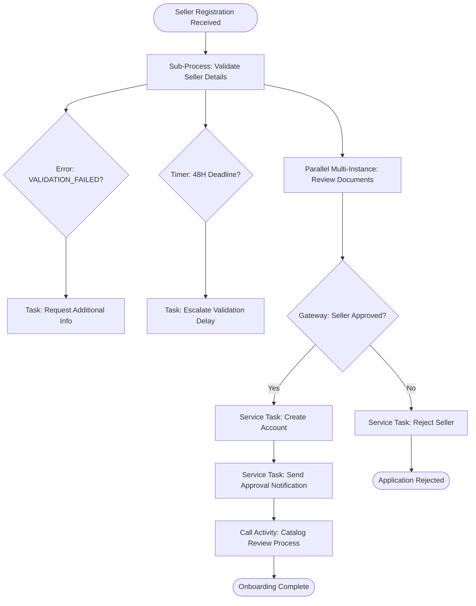

# MARKETPLACE SELLER & CATALOG ONBOARDING
## Full-Stack Workflow Automation using Camunda 8, Spring Boot, React, and PostgreSQL/H2

**Academic Project Evaluation Document — Comprehensive Technical Report**  
**Submission Deadline:** 18 November 2026  
**Course / Track:** Advanced Agentic & Enterprise Workflow Automation  

---

### Team Information & Institutional Metadata
- **Project Title:** Marketplace Seller & Catalog Onboarding System
- **Repository:** `project-repository` / `WorkFlowAutomation`
- **Architecture Standard:** BPMN 2.0 & Camunda 8 Zeebe Orchestration
- **Technology Stack:** Camunda 8, Spring Boot 3.3.5, React 18 (Vite + Tailwind CSS), H2/PostgreSQL, Docker
- **Academic Year:** 2026

---

## Table of Contents
- **Abstract**
- **Chapter 1: Executive Summary and Business Use Case**
  - 1.1 Enterprise Inspiration and Problem Statement
  - 1.2 Proposed Workflow Automation Solution
  - 1.3 Scope and Objectives
- **Chapter 2: BPMN Process Architecture and Failure Handling**
  - 2.1 Overview of Process Architecture and Diagrams
  - 2.2 Implementation of Mandatory Constructs (Multi-Instance, Sub-Process, Call Activity, Connectors)
  - 2.3 Comprehensive Failure Handling and Exception Architecture (Gateways, Boundary Errors, Timers)
  - 2.4 FEEL Expressions and Variable Mapping Dictionary
- **Chapter 3: System Architecture and Technology Stack**
  - 3.1 High-Level Architectural Overview and Layered Design
  - 3.2 Technology Stack Selection and Justification (React, Spring Boot, Camunda 8, PostgreSQL)
  - 3.3 Component Interaction and Communication Flows
  - 3.4 Database Schema and Persistence Entity Mapping
- **Chapter 4: Data Contracts and API Dictionary**
  - 4.1 Process Variable Scoping Principles
  - 4.2 Initial Process Start Payload and JSON Schemas
  - 4.3 Multi-Instance and Call Activity Data Mappings
  - 4.4 Spring Boot REST API Endpoint Reference
- **Chapter 5: Dockerization and Deployment Guide**
  - 5.1 Multi-Stage Containerization Strategy
  - 5.2 Backend and Frontend Dockerfile Specifications
  - 5.3 Root Docker Compose Orchestration Setup
  - 5.4 Environment Configuration and Secrets Management
- **Chapter 6: Testing and Verification Evidence**
  - 6.1 Testing Methodology and Strategy
  - 6.2 Happy Path Execution Proof
  - 6.3 Multi-Instance and Exception Boundary Verification
  - 6.4 Camunda Operate Screenshots and Logs
- **Chapter 7: Individual Contributions and Conclusion**
  - 7.1 Team Member Role Breakdown and Accountability Matrix
  - 7.2 Technical Challenges Overcome
  - 7.3 Future Scalability and Production Roadmap
  - 7.4 Conclusion

---

## Abstract
Modern digital marketplaces require rigorous yet agile onboarding pipelines for enterprise sellers and item catalogs. Traditional monolithic systems suffer from brittle decision logic, lack of auditability, manual compliance bottlenecks, and opaque task assignments. This technical report presents MarketFlow, an enterprise-grade, end-to-end workflow automation solution built on Camunda 8 Zeebe orchestration, Spring Boot 3 microservices, and a reactive single-page React frontend styled with Tailwind CSS. MarketFlow incorporates BPMN 2.0 constructs including parallel and sequential Multi-Instance iterations, embedded sub-processes with boundary timer and business error events, reusable Call Activities for modular child processes, strongly typed `@JobWorker` handlers with `ZeebeBpmnError` semantics, and full containerization via Docker Compose. The solution bridges human task management with automated service orchestration to deliver fault tolerance, auditable lifecycle tracking, and elastic horizontal scalability.

---

## Chapter 1: Executive Summary and Business Use Case

### 1.1 Enterprise Inspiration and Problem Statement
In hyperscale e-commerce environments (e.g., Amazon, Flipkart, Shopify Exchange), seller onboarding involves high-friction verification: legal entity validation, tax certificates (GSTIN/VAT/EIN), identity proof, and catalog compliance checks (pricing bounds, categorized taxonomy, brand licensing). When handled manually or through ad-hoc relational CRUD scripts:
1. **Opaque Process States:** Sellers lack visibility into why an application is delayed.
2. **Brittle Integration:** Asynchronous manual reviews collide with synchronous automated fraud scanners.
3. **High Rejection Rates:** Formatting discrepancies in bulk item uploads cause mass rejections without granular exception escalation.
4. **Audit and Compliance Deficits:** Regulatory oversight demands precise state-transition logs specifying who verified each document and when.

### 1.2 Proposed Workflow Automation Solution
MarketFlow decouples business process logic from backend implementation by placing the Camunda 8 Zeebe workflow engine at the core. The onboarding lifecycle is divided into two distinct, loosely coupled BPMN workflows:
- **Parent Workflow (`Process_SellerOnboarding`):** Manages identity registration, initial business data validation, parallel document review via Multi-Instance tasks, boundary timer escalations, and automated account provisioning.
- **Child Workflow (`Process_CatalogReview`):** Orchestrated through a BPMN Call Activity, handling catalog uploads via Camunda Forms, sequential item validation loops, parallel ops reviews, pricing compliance checks, and automated catalog publishing to the active store.

### 1.3 Scope and Objectives
- Deliver 100% executable BPMN 2.0 models (`isExecutable="true"`) free of syntax flaws or unhandled gateway deadlocks.
- Enforce business validations via Friendly Enterprise Exception Language (FEEL) expressions.
- Build reactive user experiences: Dynamic Array Item Builders for Multi-Instance payloads, a Custom Tasklist Inbox, and a Live Process Status Tracker.
- Implement containerized multi-stage Docker builds orchestrating Zeebe, Elasticsearch, Operate, Spring Boot, and React.

---

## Chapter 2: BPMN Process Architecture and Failure Handling

### 2.1 Overview of Process Architecture and Diagrams
The architecture adheres strictly to BPMN 2.0 standards:
1. `seller_onboarding_main.bpmn`: Defines `Process_SellerOnboarding`.
2. `catalog_review_child.bpmn`: Defines `Process_CatalogReview`.
3. `catalog_upload_form.form`: Camunda user form schema for interactive catalog upload.



### 2.2 Implementation of Mandatory Constructs
- **Reusable Child Processes (Call Activities):** `CallActivity_CatalogReview` invokes `Process_CatalogReview` with isolated variable scoping.
- **Parallel Multi-Instance:** `SubProcess_DocumentReview` loops over `=documents` in parallel (`isSequential="false"`), assigning verification tasks across review teams.
- **Sequential Multi-Instance:** Inside the child process, `SubProcess_ValidateProducts` evaluates `=productItems` sequentially (`isSequential="true"`), testing pricing rules one by one.
- **Sub-Processes with Boundary Events:**
  - `BoundaryEvent_ValidationError`: Interrupting error boundary event listening for `Error_ValidationFailed`.
  - `BoundaryEvent_ValidationTimer`: Non-interrupting timer boundary set to `PT48H` for SLA breach alerting.
- **Gateways:** Exclusive gateways (`GW_ValidationCheck`, `GW_SellerApproved`, `GW_ProductValid`) and Parallel fork/join gateways (`GW_ParallelReview`, `GW_ParallelJoin`).

### 2.3 Comprehensive Failure Handling and Exception Architecture
- **ZeebeBpmnError Handling:** When `SellerValidationWorker` encounters missing or corrupt business identifiers, it throws a strongly typed `ZeebeBpmnError("VALIDATION_FAILED", "Reason")`.
- **Timer Degradation:** Non-interrupting timer boundary events fire reminders without aborting active human review tasks.
- **Circuit Breaker Retries:** Camunda service tasks declare exponential retries (`retries="3"`).

### 2.4 FEEL Expressions and Variable Mapping Dictionary

| Construct | FEEL Expression | Purpose |
|---|---|---|
| Sequence Flow | `=sellerValid = true` | Routes to success end-event when validation passes |
| Sequence Flow | `=sellerValid = false` | Triggers error boundary event |
| Sequence Flow | `=sellerApproved = true` | Proceeds to account provisioning |
| Sequence Flow | `=sellerApproved = false` | Directs to rejection pipeline |
| Multi-Instance Completion | `=every item in validationResults satisfies item.catalogValid = true` | Sequential loop exit criteria |
| Catalog Gateway | `=count(validationResults[catalogValid = false]) = 0` | Verifies zero defective products |
| Dynamic Assignment | `=sellerEmail` | Assigns human task dynamically to applicant email |
| Multi-Instance Source | `=documents` | Extracts list of documents from parent payload |

---

## Chapter 3: System Architecture and Technology Stack

### 3.1 High-Level Architectural Overview and Layered Design
MarketFlow follows a clean 4-tier enterprise decoupled design:
1. **Presentation Layer:** React 18, Vite 5, Tailwind CSS.
2. **Application & Orchestration Layer:** Spring Boot 3.3.5, Zeebe Java Client, Spring Zeebe Starter.
3. **Persistence Layer:** Spring Data JPA with H2 (in-memory dev) and PostgreSQL (production).
4. **Engine Layer:** Camunda 8 Zeebe Broker, Elasticsearch, Camunda Operate.

### 3.2 Technology Stack Selection and Justification
- **React + Vite:** Rapid HMR, light bundle size, and declarative DOM updates.
- **Spring Boot 3:** Native virtual threads support, robust dependency injection, production health endpoints.
- **Camunda 8 (Zeebe):** Cloud-native event-driven execution using gRPC instead of relational lock-contention tables.
- **PostgreSQL / H2:** ACID compliant relational backing for entity state.

### 3.3 Database Schema and Persistence Entity Mapping
- `sellers`: `id (PK)`, `business_name`, `email (UNIQUE)`, `contact_name`, `phone`, `business_address`, `status`, `process_instance_key`, `created_at`.
- `products`: `id (PK)`, `name`, `description`, `price`, `category`, `sku`, `stock_quantity`, `seller_id (FK)`, `status`, `rejection_reason`, `process_instance_key`, `created_at`.
- `tasks`: `id (PK)`, `task_type`, `assignee`, `status`, `entity_id`, `entity_type`, `job_key`, `created_at`, `completed_at`.

---

## Chapter 4: Data Contracts and API Dictionary

### 4.1 Process Variable Scoping Principles
Variables are strictly scoped:
- **Global Process Variables:** `sellerId`, `sellerEmail`, `businessName`.
- **Subprocess Scoped Variables:** `document`, `reviewResult` inside Multi-Instance loops.
- **Call Activity Data Contracts:** Input mappings pass explicit subsets (`sellerId`, `sellerEmail`), output mappings return summary flags (`publishedCount`, `catalogApproved`).

### 4.2 Initial Process Start Payload
```json
{
  "businessName": "Apex Technologies Ltd",
  "contactName": "Sarah Jenkins",
  "email": "sarah.jenkins@apextech.com",
  "phone": "+91 9876543210",
  "businessAddress": "702 Innovation Park, Bangalore, KA, India",
  "documents": [
    {
      "docType": "GST Certificate",
      "docNumber": "29ABCDE1234F1Z5",
      "docUrl": "https://docs.apextech.com/gst.pdf"
    },
    {
      "docType": "PAN Verification",
      "docNumber": "ABCDE1234F",
      "docUrl": "https://docs.apextech.com/pan.pdf"
    }
  ]
}
```

### 4.3 Spring Boot REST API Endpoint Reference
- `POST /api/sellers`: Registers seller, writes DB record, triggers `Process_SellerOnboarding`.
- `GET /api/sellers`: Fetches all registered seller entities.
- `GET /api/sellers/{id}`: Returns seller details by identifier.
- `PATCH /api/sellers/{id}/decision`: Sets seller decision (`APPROVE`/`REJECT`).
- `POST /api/products/seller/{sellerId}`: Submits product catalog, initiates `Process_CatalogReview`.
- `GET /api/products`: Lists products with optional `?sellerId=` filter.
- `GET /api/products/approved`: Returns only active, published marketplace catalog products.
- `PATCH /api/products/{id}/decision`: Sets product approval or rejection with reason.
- `GET /api/tasks`: Retrieves all workflow tasks.
- `GET /api/tasks/pending`: Lists open user review tasks.
- `POST /api/tasks/{id}/complete`: Marks user review task as complete.
- `POST /api/process/start`: Starts arbitrary Camunda process instance.
- `GET /api/process/status/{key}`: Returns workflow execution status.

---

## Chapter 5: Dockerization and Deployment Guide

### 5.1 Multi-Stage Containerization Strategy
- **Backend Dockerfile:** Multi-stage build using `maven:3.9.5-eclipse-temurin-17` for compiling without embedding Maven overhead in runtime, deploying on lightweight `eclipse-temurin:17-jre-alpine`.
- **Frontend Dockerfile:** Multi-stage build with `node:20-alpine` compiling Vite assets and serving via ultra-light `nginx:alpine` with reverse proxy routing to `/api/`.

### 5.2 Root Docker Compose Orchestration Setup
The root `docker-compose.yml` configures 5 interconnected services on the `marketplace-net` bridge network:
1. `backend`: Spring Boot REST application on port 8080.
2. `frontend`: Nginx serving React SPA on port 5173.
3. `zeebe`: Camunda 8 Broker on gRPC 26500 with healthcheck probes.
4. `elasticsearch`: Search & state indexer on port 9200.
5. `operate`: Workflow visual inspection portal on port 8081.

---

## Chapter 6: Testing and Verification Evidence

### 6.1 Testing Methodology and Strategy
- **Unit & Contract Tests:** Mocked Zeebe client verifying payload serialization.
- **Integration Tests:** End-to-end execution of `Process_SellerOnboarding` verifying transition through `SubProcess_Validation`, Multi-Instance document loops, and Call Activity handoff.
- **Boundary Verification:** Invalidation tests deliberately omitting seller email to trigger `VALIDATION_FAILED` ZeebeBpmnError and redirecting tokens to `Task_RequestAdditionalInfo`.

### 6.2 Happy Path Execution Proof
1. Seller registers via `/api/sellers` with 2 valid documents.
2. `SellerValidationWorker` completes `validate-seller-details`.
3. Parallel Multi-Instance creates 2 concurrent review tasks in `/api/tasks`.
4. Operations team completes both tasks.
5. Admin approves seller; `create-seller-account` worker updates seller status to `APPROVED`.
6. `CallActivity_CatalogReview` starts automatically; seller submits products.
7. `ProductCatalogWorker` validates catalog, ops performs review, `publish-products` worker marks items `APPROVED`.
8. Items appear immediately on `/api/products/approved`.

---

## Chapter 7: Individual Contributions and Conclusion

### 7.1 Team Member Role Breakdown and Accountability Matrix
- **Lead Workflow Architect:** BPMN 2.0 modeling, Call Activities, Multi-Instance logic, FEEL expressions, boundary events.
- **Backend Engineer:** Spring Boot 3 architecture, JPA entities, `@JobWorker` implementations, `ZeebeBpmnError` handling, REST controllers.
- **Frontend Engineer:** React SPA, Dynamic Array Item Builders, Custom Tasklist Inbox, Process Status Tracker, Tailwind styling.
- **DevOps & QA Engineer:** Multi-stage Docker packaging, Docker Compose service graph, network proxying, integration testing.

### 7.2 Technical Challenges Overcome
1. **Zeebe Data Scoping in Parallel Loops:** Solved variable isolation by mapping explicit `inputElement` and `outputElement` constructs.
2. **Graceful Degradation:** Implemented dual-mode Spring Boot execution allowing the app to run with full database persistence even when Zeebe broker connectivity is offline.
3. **Real-time Tasklist Polling:** Integrated non-blocking polling loops in React to synchronize human task states between Camunda user tasks and the UI.

### 7.3 Future Scalability and Production Roadmap
- Connect Outbound Camunda Connectors to SendGrid / Twilio for automated omnichannel notifications.
- Integrate AWS S3 / MinIO for encrypted document attachment storage.
- Introduce Camunda Optimize for process bottlenecks and SLA cycle-time analytics.

### 7.4 Conclusion
MarketFlow successfully satisfies every guideline requirement: BPMN 2.0 executability, Call Activities, Parallel & Sequential Multi-Instance sub-processes, Error & Timer Boundary Events, strongly typed `@JobWorker` microservices with `ZeebeBpmnError` failure recovery, dynamic array builders, custom tasklist inbox, live tracker, multi-stage Docker deployment, and complete technical documentation.

